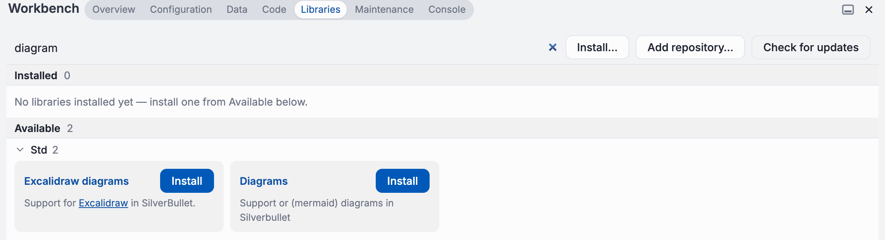
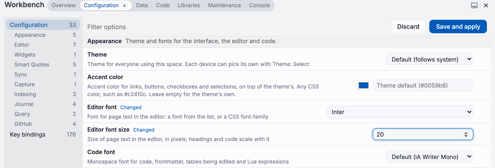

You can change how SilverBullet looks and behaves without writing code. Let’s try a different font, pick a theme, adjust a keyboard shortcut and look at the [[Reference/Concepts/Library|Libraries]] you can install.

# Discover libraries
Switch to the **Libraries** tab in the Workbench. [[Reference/Concepts/Library|Libraries]] are SilverBullet’s way to distribute customizations and new (often community created) functionality.

**Installed** shows what your space already has installed. **Available** lists libraries offered by its repositories, which are catalogs of libraries you can install.

Use **Filter libraries** to narrow the list, as shown above for diagrams. Libraries can add fonts, themes, templates, commands and other features. Filter for “theme” to see the themes on offer. An installed theme shows up in the Theme list right away. Browse their descriptions and open a library’s title to read more. 

When you find one you want, click **Install** and follow its instructions. Libraries can run code in your space, so choose sources you trust. Use the installed library’s ⋯ menu to **Remove** it later. **Check for updates** looks for newer versions. Built-in libraries cannot be removed. [[Workbench/Libraries]] covers the controls in detail.

# Get comfortable
Open any page with some text, then press **Cmd-,** on macOS or **Ctrl-,** on Windows/Linux to open Configuration in [[Workbench]]. You can also open the command palette with **Cmd-/** or **Ctrl-/** and run **Workbench: Configuration**.

Choose **Appearance** in the sidebar. Experiment with the font options. Each change applies and saves right away; a typed value such as the font size saves when you leave the field or press **Enter**.

The interface, page text and code each have their own font setting. Try the built-in choices to find what suits you. [[Reference/Theming/Fonts]] explains the choices.

To undo a setting, open its ⋯ menu and choose **Reset to default**.

# Pick a theme
A [[Reference/Theming|theme]] sets SilverBullet’s colors. Still under **Appearance**, open the **Theme** list. Pick one and it applies right away.

Want your own touch without a whole new theme? Pick an **Accent color**, also under Appearance. It recolors links, buttons, checkboxes and selections in whatever theme is active. Clear it to get the theme’s own color back.

The theme you save here is for the whole space. To try themes on just this device, open the command palette and run ${widgets.commandButton("Theme: Select")}: your choice there wins over the space’s theme, and other people sharing the space won’t see it.

# Choose a shortcut
In Configuration, select **Key bindings** and use the filter to find a command you use often. **Journal: Today** is one option if you keep a journal.

1. Click **+** beside the command to add an alternate shortcut.
2. Press the keys you want to use, then press **Enter** to keep them.
3. If SilverBullet reports a conflict, choose another combination.
4. Return to the editor and try your shortcut: it is saved already.

The command’s ⋯ menu offers **Reset** if you want its default bindings back. See [[Keyboard Shortcuts]] for reserved keys and shortcuts made of several keystrokes.

# Where your changes live
Configuration saves your settings and shortcuts in a page called [[^Library/Config]]. They belong to the space, so in a shared space they also affect other people using it.

Workbench writes the configuration as [[Reference/Space Lua]] for you. You can inspect [[^Library/Config]] when you’re curious.

# Go further
* [[Reference/Concepts/Page Template]] and [[Reference/Concepts/Slash Templates]] let you reuse content when creating pages or inserting sections.
* [[Reference/Space Lua]] lets you add your own commands, views and behavior.
* [[Reference/Theming]] explains how themes are applied and how to adjust one, and [[Theming/Creating a Theme]] how to write your own.
* [[Reference/Theming/Space Style]] lets you change colors, spacing and other styling with CSS.