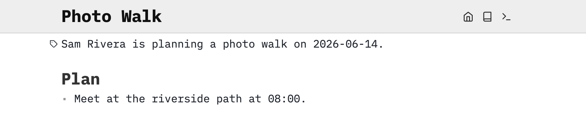
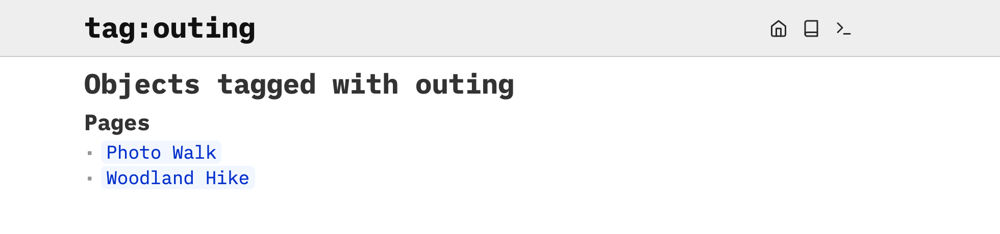
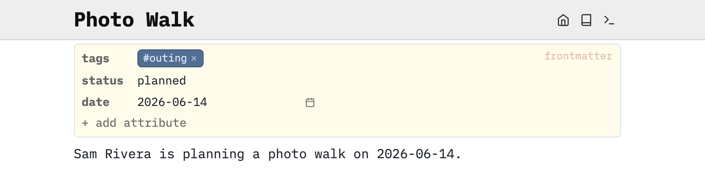
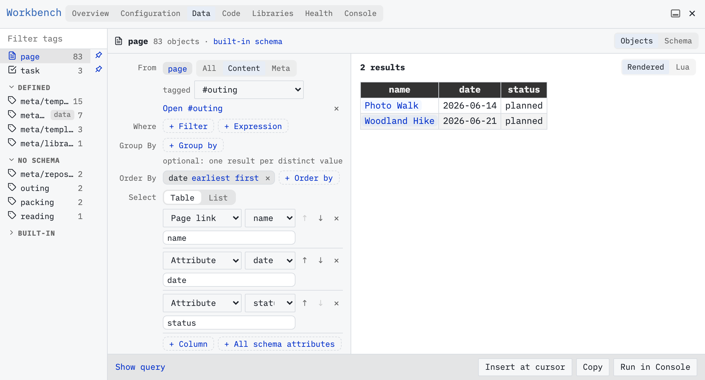
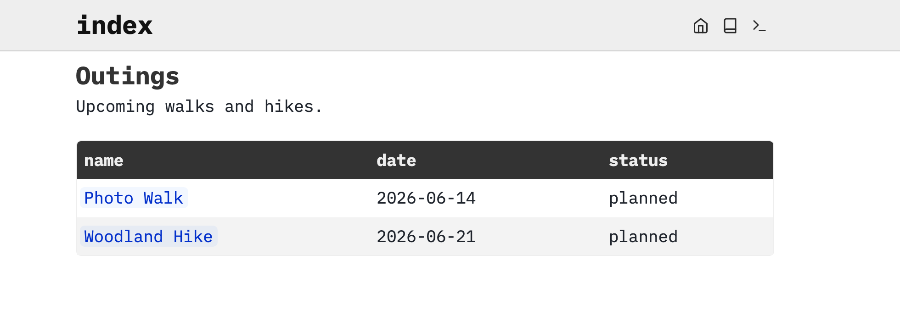

When patterns start to emerge in your note taking, you may start to add a sprinkle of [[Metadata]] through the use of [[Frontmatter]] and use that to [[Workbench/Data]] your space.

# Tag it
We’ll continue our journey from [[Guide/Find and Connect Pages]].

On `Photo Walk`, move the mouse over the first line or the empty area just above it. A faint tag icon appears to the left, labeled **add tag**.


Click the icon to open a small attribute form at the top of a new page, with its **tags** field focused. Type `outing` and press Enter.

If you followed [[Guide/Find and Connect Pages]], you already have `Woodland Hike`. Open it by following the link on `Photo Walk`. Let’s give this outing the same tag.

# What is a [[Tag]]?
A [[Tag]] is a way to classify [[Object|Objects]] or “things.” In SilverBullet they can be applied to [[Tag/page|pages]], [[Tag/task|tasks]], (numbered and bulleted) list [[Tag/item|items]], [[Tag/paragraph|paragraphs]], and custom [[Tag/data]] encoded in fenced code blocks.

You use tags when you think it’s useful to collect things of this type across your space. The example used here is `outing`. Other examples could be `animal`, `friend`, or `project`.

Click the `outing` tag in either page’s attribute form. Its tag page collects the objects carrying that tag, grouped by kind.



# Add attributes
Return to `Photo Walk`. Use **+ add attribute** below the tag field to record more about the outing.

1. Type `status`, then press **Enter** to add that name. Choose **string** as its type, enter `planned`, and press Enter to save the value.
2. Click **+ add attribute** again, type `date`, and press **Enter**. Choose **date** as its type, then enter `2026-06-14` in the date field or use the date picker.

These values are [[Attribute|attributes]]. You now have a page tagged `outing`, with a status and a date.



Add similar metadata to the `Woodland Hike` page too:

* Add `status` as a **string**, with the value `planned`.
* Add `date` as a **date**, with the value `2026-06-21`.

# Under the hood
These page attributes are called [[Frontmatter|frontmatter]]. To inspect their source, choose **Edit source** from the form’s ⋯ menu (or **Alt-click** on the form). The form stores a block like this at the very beginning of `Photo Walk`:

```markdown
---
tags: outing
status: planned
date: "2026-06-14"
---
```

The two `---` lines mark the block’s boundaries. Inside, [[YAML]] writes each attribute as `name: value`. Your original notes follow the closing `---`. Move the cursor out of the block to return to the form. You can use either editor. They change the same attributes.

# Build an outing list
You can use the same attributes to make a live overview of your outings. Open the command palette with **Cmd-/** (Mac) **Ctrl-/** (Linux/Windows) and run **Workbench: Data**.

1. Select `page` under **Root**. Beside **From**, choose `#outing` in the **tagged** dropdown.
2. Keep **Table** under **Select**. Keep the `name`, `date` and `status` columns, removing the others. If one is missing, add it using **+ Column**. Set the `name` column’s kind to **Page link** so you can open pages from the results. Use the column arrows to put `date` before `status`.
3. Under **Order By**, click **+ Order by**, choose `date`, and add the order. Use ascending order so the earlier outing comes first.

The preview should show `Photo Walk` dated June 14, then `Woodland Hike` dated June 21, both with status `planned`. Other pages tagged `outing` in your space will appear too. If a page or attribute is missing, check its form and allow a moment for saving and indexing.



This is a query: a saved instruction to find matching objects and show selected attributes. Workbench writes it for you using SilverBullet’s query language.

# Keep the list on your index page
Return to your index page with the home button. In a new space this is `index`. Add a heading, `# Outings`, and put the cursor on the empty line below it. Keep Workbench open while you do this.

Click **Insert at cursor** in Workbench, then close the panel. The table now appears below `Outings`. Its rows come from the original pages, so you can open an outing from the result rather than maintaining a second copy.



Try changing `Woodland Hike`’s status to `completed`, then return to the index page. After saving and indexing, its row should show the new status. You can change it back to `planned` to restore the example.

To adjust the list later, open its ⋯ menu and choose **Edit in query builder**. Workbench opens the existing query and offers **Update page**. Use that to save changes instead of inserting another copy.

For task lists, see [[Guide/Task Management]].