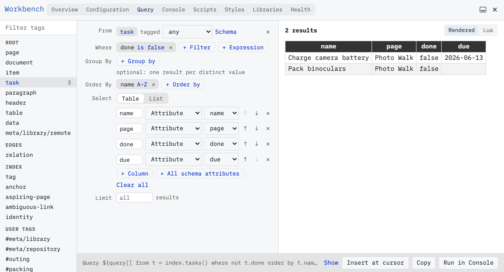
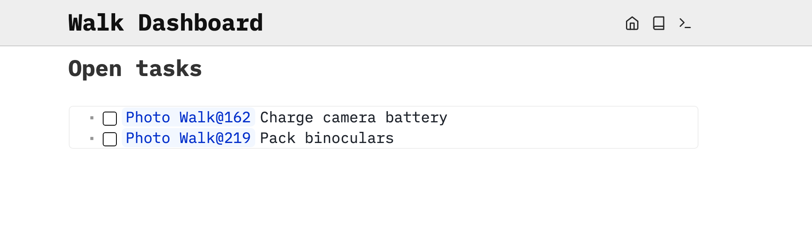

Build a live list of unfinished tasks in Workbench and put it on a page.

# Set up the source tasks
Use your own writable SilverBullet space; the published documentation is read-only. Open the page picker with **Cmd-k / Ctrl-k**, type `Photo Walk`, and press **Shift-Enter** to open that exact name. If you already have this example, reuse it and check it against the complete sample, including its attributes, task tags and checkbox states, instead of adding the content again. Otherwise, paste the following into the page body, without the surrounding backticks:

```markdown
---
tags: outing
status: planned
date: "2026-06-14"
---
Sam Rivera is planning a photo walk on 2026-06-14.

# Pack
* [ ] Charge camera battery #packing [due: "2026-06-13"]
* [ ] Pack binoculars #packing
* [x] Check the weather
```

SilverBullet saves automatically. Leave the two packing tasks unchecked and the weather task checked. Allow a moment for saving and indexing before checking the results. The dates are fixed example data.

# Prepare the destination
Open the page picker with **Cmd-k / Ctrl-k**, type `Walk Dashboard`, and press **Shift-Enter**. Write `# Open tasks` and put your cursor on a blank line below it. If the page already contains this query, use its **Edit in query builder** menu instead of inserting a duplicate. Open the command palette with **Cmd-/ / Ctrl-/**, search for `Workbench: Query`, and run it.

SilverBullet stores this query as text in your page. It uses SLIQ, a query language built into Space Lua. You can build and edit it in Workbench without learning the syntax.

# Filter and sort visually
1. Select `task` under **Root**. Check that the three `Photo Walk` tasks are present before filtering.
2. Under **Where**, click **+ Filter**, choose `done`, choose **is false**, and apply the filter. The completed weather task disappears.
3. Add another filter: `page` **is** `Photo Walk`. This keeps the exercise focused even if your space already contains other tasks.
4. Under **Order By**, add `name` and use **A–Z** order. Click an existing order to reverse its direction if necessary.
5. Optional: explore table columns. Under **Select**, keep **Table** initially. Remove columns you do not need, leaving `name`, `page`, `done` and `due`. This is how you choose fields rather than changing the stored tasks.
6. Switch **Select** to **List** and choose `templates.taskItem` from **Template**. The preview now shows tasks with working checkboxes and references to their source.
7. Set **Limit** to `10`.

You should see `Charge camera battery` followed by `Pack binoculars`, both unchecked. If either task is complete, uncheck it on `Photo Walk` to match this example. The preview is the result; the text along the bottom is how SilverBullet will store the instructions.



The Table view during setup, before switching to List. In this small fixture all tasks belong to Photo Walk; add the page filter when working in a larger space.

# Put the list on your page
Click **Insert at cursor**. Close or move away from Workbench to see the live list below `Open tasks` on `Walk Dashboard`. You inserted a query, rather than copying the two tasks into a second location.

To edit it again, open the result widget’s menu and choose **Edit in query builder**. Alternatively, reveal the source, put the cursor in the query, and run `Workbench: Edit Query`. Workbench now offers **Update page** in place of **Insert at cursor**. Change the limit to `5` and click **Update page**. Further builder edits continue to update that opened query.



The inserted List view links back to the original tasks.

# Watch a result update
Open `Photo Walk` and check `Charge camera battery`. Return to `Walk Dashboard`. After saving and indexing, the live list should contain only `Pack binoculars`. You can also check a task directly in a list rendered with `templates.taskItem`; it changes the original task.

Uncheck the battery task on `Photo Walk` to bring it back to the live list. These updates happen automatically after content changes; `System: Reload` is for a different purpose. [[Guide/When Results Update]] explains the timing.
