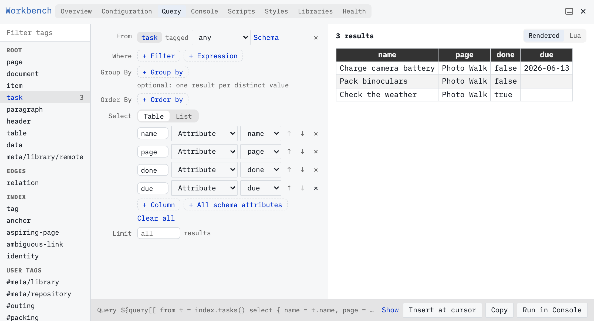

Use [[Workbench]] to inspect pages and tasks without writing a query.

# Set up a practice page
Use your own writable SilverBullet space; the published documentation is read-only. Open the page picker with **Cmd-k / Ctrl-k**, type `Photo Walk`, and press **Shift-Enter** to open that exact name. If you already have this example, reuse it and check it against the complete sample, including its attributes, task tags and checkbox states, instead of adding the content again. Otherwise, paste the following into the page body, without the surrounding backticks:

```markdown
---
tags: outing
status: planned
date: "2026-06-14"
---
Sam Rivera is planning a photo walk on 2026-06-14.

# Pack
* [ ] Charge camera battery #packing [due: "2026-06-13"]
* [ ] Pack binoculars #packing
* [x] Check the weather
```

SilverBullet saves automatically. Leave the two packing tasks unchecked and the weather task checked. Allow a moment for saving and indexing before checking the results. The dates are fixed example data.

Open `Reading List` the same way: **Cmd-k / Ctrl-k**, type its name, then **Shift-Enter**. Reuse it if it already exists; otherwise paste:

```markdown
---
tags: reading
status: active
---
Books to bring along or read after the walk.

# To read
* The Art of Noticing — Rob Walker
* A Field Guide to the Birds — Roger Tory Peterson

Bring a notebook on the [[Photo Walk]].
```

# Open the Query tab
In your writable practice space, open the command palette with **Cmd-/ / Ctrl-/**, search for `Workbench: Query`, and run it. Workbench opens beside your page. Its **Query** tab has a tag list, a query editor and a result preview.

Select `page` under **Root** in the tag list. The results are page records; you should find `Photo Walk` and `Reading List`. The default page source excludes [[Meta Page|meta pages]] such as configuration and library pages. Other content pages in your space may also appear.

Select `task` under **Root**. The three tasks from `Photo Walk` should appear, alongside any tasks you already had. Look at `done`: it is false for the two packing tasks and true for `Check the weather`. `page` identifies where each task lives. The task’s `name` contains its text.



Three tasks in Workbench. The screenshot keeps four columns visible; your initial preview may show more.

# Inspect your attributes
Click **Schema** beside **From** to see the available attributes, their types, sample values and how they were discovered. Find `due` among the task attributes. It has a value on the battery task but can be absent on other tasks. Close the schema panel when you have finished looking.

Select `#outing` under **User tags** to inspect records associated with that tag. The page carries it explicitly; its tasks can inherit it. Select `#packing` to inspect the two tasks carrying that tag. A user tag can apply to different kinds of things; do not assume every tagged result is a page. Selecting a different source can clear incompatible query settings; Workbench offers **Undo** when that happens.

# Two names for what you see
SilverBullet calls a page record or task record an **[[Object|object]]**. A record’s attributes are the fields you see in the table. The **[[Object Index|index]]** is the searchable representation SilverBullet builds from your notes. You keep editing Markdown; the index makes those changes available to Workbench and live lists.

New edits take a little time to be indexed. If a task or attribute is missing immediately after you write it, wait briefly and inspect again. Do not reload definitions just to make an ordinary note edit visible. See [[Guide/When Results Update]] if a result continues to look stale.

To turn inspected records into a live list, use [[Guide/Build Your First Query]]. No query syntax is required; [[Workbench/Query]] describes every control when you need a reference.
