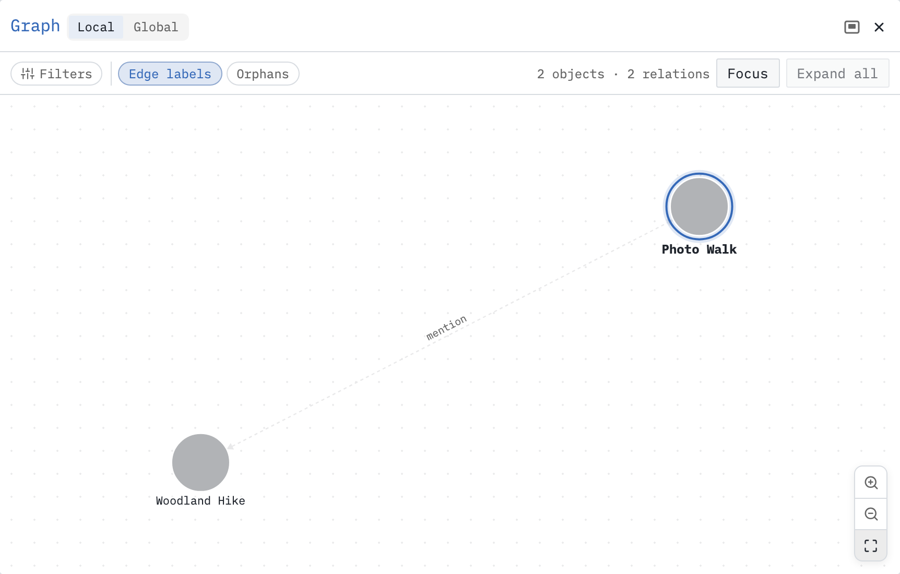

Link pages, follow backlinks and see their connections in the graph view.

We’ll continue the photo walk from [[Guide/My First Markdown Page]] and link it to another outing.

# Create the linked page
On `Photo Walk`, click `Woodland Hike`. A link can name a page before it even exists (although it will appear in orangy-red). Following the link opens that page so we can start writing it.

You can also open the page picker, type `Woodland Hike` and notice that it’s already in the list _even though it does not exist_. This is what’s called an [[Aspiring Pages|Aspiring Page]]: it’s a page that does _not yet_ exist, but is already linked to. It’s _aspiring_ to become a real page one day. Today is that day.

On `Woodland Hike`, enter the following content:

```markdown
Sam Rivera is planning a woodland hike on 2026-06-21.

# Plan
* Follow the woodland trail.
* Bring the camera from our [[Photo Walk]].
```

We now have two outing pages, with a link in each direction.

# Bidirectional linking
Click `Photo Walk` on `Woodland Hike`. You should return to the plan. Look for [[Linked Mention|Linked Mentions]] at the bottom of the page, normally docked below the page: it shows the excerpt from `Woodland Hike` that points here. Open `Woodland Hike` again and its linked mentions show the reference from `Photo Walk`.

These are [[Linked Mention|backlinks]]. You wrote the original links, SilverBullet found the reverse references. Linked Mentions are another powerful way for [[Discovery]] in your space.

# Graphing it out
Open `Photo Walk` and press **Cmd-Shift-g** on macOS or **Ctrl-Shift-g** on Windows/Linux, or run `Graph: Explore` from the command palette (**Cmd-/ / Ctrl-/**).

This [[Graph View|graph view]] shows connections around the current page. Switch to **Global** to see the pages across your space. Look for `Photo Walk` and `Woodland Hike`, connected by their links. Other pages in your space may appear too.


Double-click a page’s node to open it. Scroll or pinch to zoom, and drag empty space to move around the graph. When you click nodes the expand to also reveal their relations to other pages and objects.

The graph gives you another way to explore your pages through links you have already created. It needs no tags or queries. See [[Graph View]] for filters, additional relationships and docking options.

# The linking habit
#protip As you will discover, it is beneficial to _link liberally_. If you think some word or concept is significant and may need more elaboration (its own page) later — link it! Even if you don’t create the page you link to yet, it’s worth linking to. Once you linked to it once, future auto completes after typing `[[` will show it _even if it doesn’t exist yet_. Later you can create the page, even as one without content just so you can see all the locations that link to it with [[Linked Mention|Linked Mentions]].

# Find a page without a link
While using the [[Page Picker]] is a common way to move around, you may also like to use the [[File Tree]] instead.

If you remember the contents of a page, but not the title, open [[Search]] with **Cmd-Shift-f / Ctrl-Shift-f**. Search for `binoculars`. Open the `Photo Walk` result to return to its task.