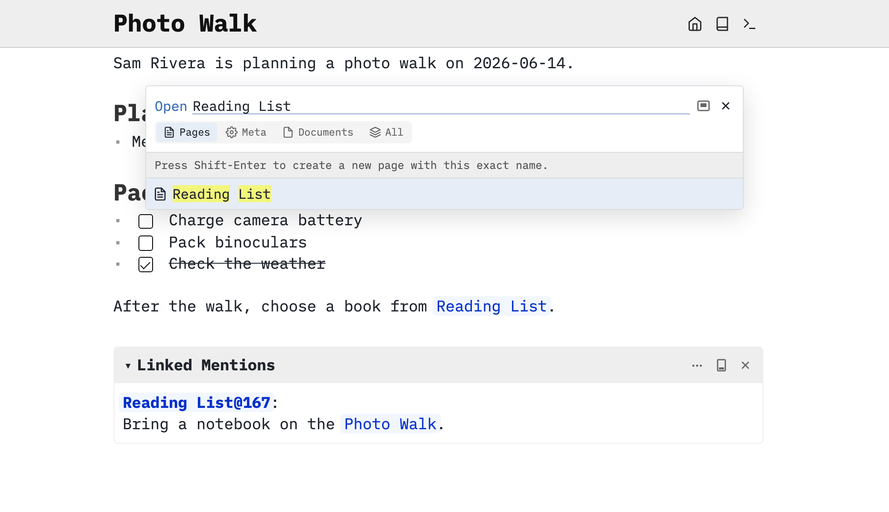

Link two pages, follow backlinks and see their connections in the graph view.

# Set up a practice page
Use your own writable SilverBullet space, such as a local Desktop space or a Server space where you can edit. The published documentation is read-only; do these actions in your practice space. You do not need tags, queries or Lua for this guide.

Press **Cmd-k** on macOS or **Ctrl-k** on Windows/Linux to open the [[Page Picker]]. Type `Photo Walk`, then press **Shift-Enter** to open that exact name. A new page is saved when you write its content. If you already have these example pages, reuse their matching content rather than pasting it twice. Paste the following into its body, copying the block’s contents without the surrounding backticks:

```markdown
Sam Rivera is planning a photo walk on 2026-06-14.

# Plan
* Meet at the riverside path at 08:00.

# Pack
* [ ] Charge camera battery
* [ ] Pack binoculars
* [x] Check the weather

After the walk, choose a book from [[Reading List]].
```

SilverBullet saves automatically. You should see a plan, two incomplete tasks, one completed task and a link to `Reading List`.

# Create the linked page
On `Photo Walk`, click `Reading List`. A link can name a page before it has content. Alternatively, open the page picker, type `Reading List` and press **Shift-Enter**. Paste the following into that page’s body:

```markdown
Books to bring along or read after the walk.

# To read
* The Art of Noticing — Rob Walker
* A Field Guide to the Birds — Roger Tory Peterson

Bring a notebook on the [[Photo Walk]].
```

If the link text is being edited instead of followed, move the cursor elsewhere first or open `Reading List` through the page picker. Page links use double brackets and omit `.md`.

# Follow the connection both ways
Click `Photo Walk` on your reading list. You should return to the plan. Look for **Linked Mentions**, normally docked below the page: it shows the excerpt from `Reading List` that points here. Open `Reading List` again and its linked mentions show the reference from `Photo Walk`.

These are [[Linked Mention|backlinks]]. You wrote the original links; SilverBullet found the reverse references. Allow a moment for recently edited pages to appear. You do not need to copy a list of backlinks into either page.

# See the connections in the graph
Open `Photo Walk` and press **Cmd-Shift-g** on macOS or **Ctrl-Shift-g** on Windows/Linux, or run `Graph: Explore` from the command palette (**Cmd-/ / Ctrl-/**).

The [[Graph View|graph view]] opens on **Local**, showing connections around the current page. Switch to **Global** to see the pages across your space. Look for `Photo Walk` and `Reading List`, connected by their links; other pages in your space may appear too.


The two practice pages in Local Graph View after choosing **Expand all**, with **Filters** hidden to give the graph more room. [[Screenshots/graph-view-local.png|Open the full-size screenshot]].

Double-click a page’s node to open it. Scroll or pinch to zoom, and drag empty space to move around the graph. Press **Esc** to close the graph window. The graph gives you another way to explore links you have already written; it needs no tags or queries. See [[Graph View]] for filters, additional relationships and docking options.

# Find a page without a link
Use **Cmd-k / Ctrl-k**, type part of a page name and select the result. **Enter** opens the highlighted result; **Shift-Enter** opens the exact name you typed, which is useful when creating a page.

If you remember the contents but not the title, open [[Search]] with **Cmd-Shift-f / Ctrl-Shift-f**. Search for `binoculars` in **All words** mode. Open the `Photo Walk` result to return to its task.



The page picker finds the linked page by name.

# Keep linking as you write
A page can reference a book, a person or an idea without needing a folder for each kind. Type `[[` to get page-name suggestions. Use an explicit page path such as `[[Books/Field Notes]]` when the destination lives in a folder; links start at the space root.

You can stop here and use SilverBullet as a notebook of linked Markdown pages. [[Guide/Find Pages]] compares the other navigation tools when your space grows.
