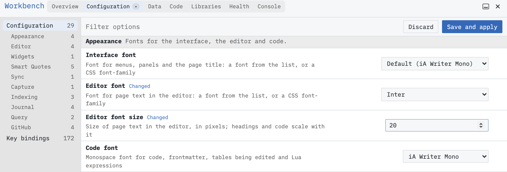
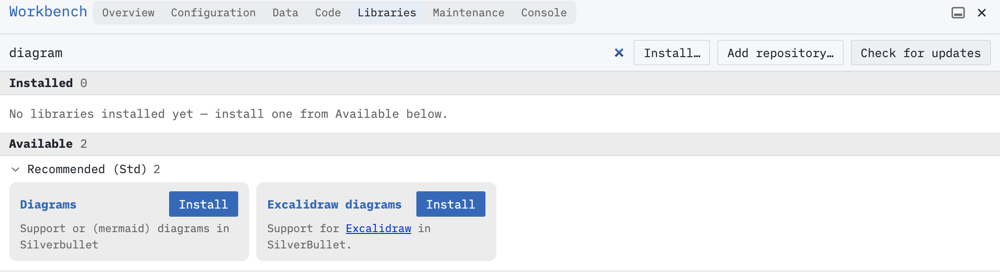

You can change how SilverBullet looks and behaves without writing code. Let’s try a different font, adjust a keyboard shortcut and look at the [[Library|Libraries]] you can install.

# Get comfortable
Open any page with some text, then press **Cmd-,** on macOS or **Ctrl-,** on Windows/Linux to open Configuration in [[Workbench]]. You can also open the command palette with **Cmd-/** or **Ctrl-/** and run **Workbench: Configuration**.

Choose **Appearance** in the sidebar. Experiment with the font options (the changes should apply instantly) and once you’re happy, click **Save and apply**.

The interface, page text and code each have their own font setting. Try the built-in choices to find what suits you. [[Fonts]] explains the choices.

To undo a saved setting, open its ⋯ menu, choose **Reset to default**, then **Save and apply** again.

# Choose a shortcut
In Configuration, select **Key bindings** and use the filter to find a command you use often. **Journal: Today** is one option if you keep a journal.

1. Click **+** beside the command to add an alternate shortcut.
2. Press the keys you want to use, then press **Enter** to keep them.
3. If SilverBullet reports a conflict, choose another combination.
4. Click **Save and apply**, return to the editor and try your shortcut.

The command’s ⋯ menu offers **Reset** if you want its default bindings back. Save again to apply that reset. See [[Keyboard Shortcuts]] for reserved keys and shortcuts made of several keystrokes.

# Discover libraries
Switch to the **Libraries** tab in the Workbench. [[Library|Libraries]] are SilverBullet’s way to distribute customizations and new (often community created) functionality.

**Installed** shows what your space already has installed. **Available** lists libraries offered by its repositories, which are catalogs of libraries you can install.

Use **Filter libraries** to narrow the list, as shown above for diagrams. Libraries can add fonts, themes, templates, commands and other features. Browse their descriptions and open a library’s title to read more. 

When you find one you want, click **Install** and follow its instructions. Libraries can run code in your space, so choose sources you trust. Use the installed library’s ⋯ menu to **Remove** it later. **Check for updates** looks for newer versions. Built-in libraries cannot be removed. [[Workbench/Libraries]] covers the controls in detail.

# Where your changes live
Configuration saves your settings and shortcuts in a page called [[^Library/Config]]. They belong to the space, so in a shared space they also affect other people using it.

Workbench writes the configuration as [[Space Lua]] for you. You can inspect [[^Library/Config]] when you’re curious.

# Go further
* [[Page Template]] and [[Slash Templates]] let you reuse content when creating pages or inserting sections.
* [[Space Lua]] lets you add your own commands, views and behavior.
* [[Theming]] explains how to pick a theme for your space or just this device, and how to write your own.
* [[Space Style]] lets you change colors, spacing and other styling with CSS.