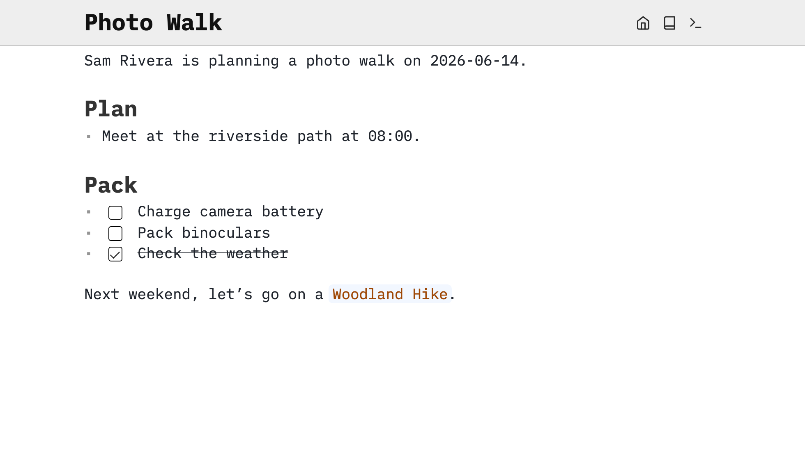

Let’s create a page and get familiar with the markdown you’ll use to write in SilverBullet.

# Creating a page
In your space, press **Cmd-k** on macOS or **Ctrl-k** on Windows/Linux to open the [[Page Picker]] (or click the book icon in the top navigation bar).

The Page Picker serves two purposes:
1. Navigating to _existing_ pages
2. Creating _new_ pages

While unusual to mix these activities, it has a purpose: [[Discovery]]. It is quite common that we want to create pages about topics we’ve already created pages for _before, but we’ve forgotten_.

Using the page picker to create new pages, this “rediscovery” tends to happen organically, as those pages (may) resurface as you type in the name of your new page.

In the page picker input box type `Photo Walk`, then press **Shift-Enter** to create a page with exactly that name. If your space already contains other pages that match “photo walk” in their name, they may appear here too and hitting **Enter** would open that old page rather than create a new page, pressing **Shift-Enter** ensures you create a new page.

It’s time to start typing. Enter the following markdown (or copy and paste it):

```markdown
Sam Rivera is planning a photo walk on 2026-06-14.

# Plan
* Meet at the riverside path at 08:00.

# Pack
* [ ] Charge camera battery
* [ ] Pack binoculars
* [x] Check the weather

Next weekend, let’s go on a [[Woodland Hike]].
```

# [[Live Preview]] in action
As you’ll notice as you type, the markdown codes disappear when you move out your cursor, and the text renders as intended.



A blank line separates paragraphs. `# Plan` becomes a heading, `*` starts a bullet, and `* [ ]` becomes an unchecked task. `[x]` is a completed task. `[[Woodland Hike]]` is a link to a page named `Woodland Hike`. The destination does not have to exist yet: follow the link and write content there whenever you’re ready to create it.

#protip While you can type all this markdown by hand, you don’t have to. Try a [[Slash Command]]. Type `/today` to insert today’s date, or `/task` to turn the current line into a task. Or `/h1` to create a heading. You can edit the markdown it inserts just like anything you typed yourself.

#protip Use **Alt/Option-click** on any rendered element if you need to reveal its source and move your cursor there.

And in case you were wondering — SilverBullet saves edits automatically. There is no Save button.

# Dive into [[Markdown]]
Now that we have a page, let’s try a few more things. You can add these examples to `Photo Walk`, either by typing them out or copying and pasting them.

## Bold and italic text
```markdown
Bring **a charged battery** and wear _comfortable shoes_.
```

We don’t want to forget that battery, so let’s make it **bold** by putting two asterisks on either side. For _italics_, use an underscore on either side, as with the comfortable shoes.

#protip There are keyboard shortcuts for many markdown codes, including bold (**Cmd-b** on Mac, **Ctrl-b** on Linux and Windows), italic (**Cmd-i** on Mac, **Ctrl-i** on Linux and Windows), discover them by bringing up the [[Command Palette]] (**Cmd-/** on Mac, **Ctrl-/** on Linux and Windows).

## Headings and lists
We already used `# Plan` and `# Pack` to give our page some structure. You can go a level deeper with `##`, and deeper still with `###`. Just leave a space after the `#` characters. Let’s add a route:

```markdown
# Route
## Riverside path
Start at the footbridge.

### Photo stops
1. Photograph the reflections.
2. Look for birds near the reeds.

## Alternative route
* Take the woodland trail if the river path is closed.
* Bring waterproof shoes.
```

Notice the numbered list under “Photo stops.” Use numbers when the order matters, and bullets when it doesn’t. For things you want to check off, we already have our packing list. A blank line keeps a list separate from the paragraph around it.

#protip Do you end up working with lists a lot? Have a look at SilverBullet’s [[Outlines|Outline]] features.

## Website links and page links
You’ll probably want to link to a website at some point. Put the text you want to show in square brackets, followed by the address in parentheses:

```markdown
This plan is kept in [SilverBullet](https://silverbullet.md).
```

This turns “SilverBullet” into a clickable link. Try replacing it with a website relevant to your walk.

#protip An even more convenient way to link some text is to copy a link to your clipboard, select the text link in SilverBullet and pasting — this turns the selected text into a link instantly.

Links to pages _inside your space_ use the double square brackets we saw earlier:

```markdown
Next weekend, let’s go on a [[Woodland Hike]].
See [[Woodland Hike|next weekend’s plan]] for ideas.
```

Both links take you to `Woodland Hike`, but the second one shows “next weekend’s plan” as its alias text. The `|` separates the page name from what you want the link to say. Try typing `[[` and SilverBullet will suggest pages as you type. And remember: the page doesn’t have to exist yet.

## Quotations
Perhaps someone sent you a reminder that you want to keep in your plan. Start the line with `>` to make it a quote:

```markdown
> Meet at the footbridge, even if it’s cloudy.

Sam’s reminder for the group.
```

Leave a blank line after the quote to go back to ordinary text.

## Footnotes
Sometimes you want to add a detail without sending the reader on a detour in the middle of a sentence. That’s what footnotes are for:

```markdown
Meet by the old footbridge.[^meeting-point]

[^meeting-point]: Use the entrance beside the bicycle racks.
```

The two `meeting-point` labels belong together: one marks the spot in the sentence, the other supplies the detail. You can choose your own label, as long as both match. Move your cursor away, then hover over the little footnote marker to read it. Clicking it takes you to the definition. There are a few more options under [[Markdown/Footnotes]].

## Inline code and code blocks
What if you want to write a filename, or a bit of code? Put a backtick on either side:

```markdown
The first photo is `IMG_0001.jpg`.
```

You’ll see the filename formatted like this: `IMG_0001.jpg`.

For several lines, use three backticks on a line of their own to start and end a code block. Let’s try a little JavaScript:

````markdown
```javascript
const destination = "the riverside"
console.log(`Let’s take some photos at ${destination}!`)
```
````

The `javascript` after the opening backticks tells SilverBullet which language we’re using, so it can apply [[Markdown/Syntax Highlighting|syntax highlighting]]. The block displays the code, it doesn’t run it.

Have a look at [[Markdown]] to learn more about this elegant markup language.
