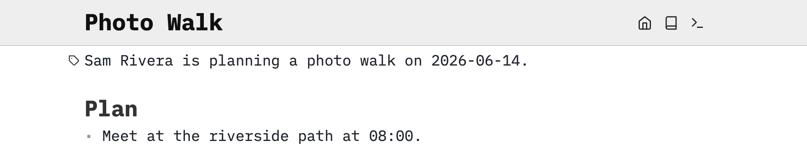
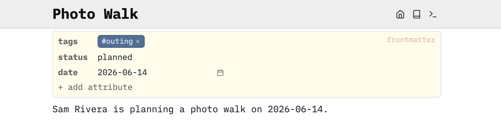

Add a category and a few values only when you want to find or compare similar notes.

# Set up a plain note
Use your own writable SilverBullet space, such as a local Desktop space or a Server space where you can edit. The published documentation is read-only. Start with a plain note so you can add its tag and attributes using the visual controls.

Press **Cmd-k** on macOS or **Ctrl-k** on Windows/Linux to open the [[Page Picker]]. Type `Photo Walk`, then press **Shift-Enter** to open that exact name. Paste the following into its body, copying the block’s contents without the surrounding backticks. If this example already exists, reuse its content instead of pasting it twice. On a new page, do not add anything above the opening paragraph yet:

```markdown
Sam Rivera is planning a photo walk on 2026-06-14.

# Plan
* Meet at the riverside path at 08:00.

# Pack
* [ ] Charge camera battery
* [ ] Pack binoculars
* [x] Check the weather

After the walk, choose a book from [[Reading List]].
```

SilverBullet saves automatically. Keep the two packing tasks unchecked and the weather task checked. The note’s link can point to `Reading List` before that page exists; you will create it below.

# Add a page tag
On `Photo Walk`, move the mouse over the first line or the empty area just above it. A faint tag icon appears to the left, labeled **add tag**. It appears only on pages without frontmatter. If your page already has a form at the top, edit its **tags** field there instead.

Click the icon to open a small attribute form at the top of a new page, with its **tags** field focused. Type `outing` and press Enter. The tag describes the whole page; your existing notes stay below the form.



Hover at the top of a page without frontmatter to reveal **add tag**.

# Add attributes
Use **+ add attribute** below the tag field to record more about the outing. If `status` or `date` already exists, edit its value in the form instead of adding it again:

1. Type `status`, then press Shift-Enter to add that name. Choose **string** as its type, enter `planned`, and press Enter to save the value.
2. Click **+ add attribute** again, type `date`, and press Shift-Enter. Choose **date** as its type, then enter `2026-06-14` in the date field and press Enter.

These values are [[Attribute|attributes]]. You now have a page tagged `outing`, with a status and a date. The date is fixed for this exercise; it is not a claim that the walk is upcoming today.



The form edits the same file as the notes below it. You can change these values here without writing YAML.

# See what is stored underneath
These page attributes are called [[Frontmatter|frontmatter]]. To inspect their source, choose **Edit source** from the form’s ⋯ menu. The form stores a block like this at the very beginning of `Photo Walk`:

```markdown
---
tags: outing
status: planned
date: "2026-06-14"
---
```

The two `---` lines mark the block’s boundaries. Inside, [[YAML]] writes each attribute as `name: value`. Your original notes follow the closing `---`. Move the cursor out of the block to return to the form. You can use either editor; they change the same attributes.

A standalone paragraph containing only `#outing` also tags the page. Once you use frontmatter, keep page tags in its `tags` field; you do not need both forms.

# Annotate individual tasks
Replace the two unchecked task lines on `Photo Walk` with:

```markdown
* [ ] Charge camera battery #packing [due: "2026-06-13"]
* [ ] Pack binoculars #packing
```

`#packing` belongs to each task because it is written on that task. `[due: "2026-06-13"]` belongs only to the battery task. It does not set a due date for the whole page or for the binoculars task. Completing either task changes its checkbox; it does not change the page’s `status` automatically.

# Categorize the reading list
Open the page picker with **Cmd-k / Ctrl-k**, type `Reading List` and press **Shift-Enter**. Paste this plain Markdown into the page’s body:

```markdown
Books to bring along or read after the walk.

# To read
* The Art of Noticing — Rob Walker
* A Field Guide to the Birds — Roger Tory Peterson

Bring a notebook on the [[Photo Walk]].
```

Move the mouse over its first line, click **add tag**, type `reading` and press Enter. Use **+ add attribute**, type `status` and press **Shift-Enter**. Choose **string**, enter `active` and press Enter.

This describes the reading-list page. Its two book bullets remain ordinary list items; they are not separate book pages. If you later want an author and reading status for each book, give each book a page or use a [[Tag/data|data block]]. You do not need that extra structure for this lesson.

# Check the scope
* `Photo Walk` is a page tagged `outing` with `status: planned`.
* Its first two tasks are tagged `packing`; only the first has a `due` attribute.
* `Reading List` is a page tagged `reading` with `status: active`.

A hashtag in an ordinary paragraph tags that paragraph. A hashtag standing alone tags the page. Page and ancestor information may also be inherited by contained objects; [[Tag]], [[Attribute]] and [[Markdown/Hashtags#Scope rules]] describe those distinctions precisely.
