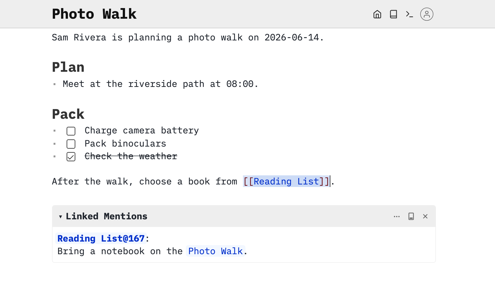

Learn how to read, reveal and copy examples from this read-only documentation space. You can inspect the examples here without setting anything up; trying changes requires a separate writable SilverBullet space.

# Keep two spaces open
Open the documentation in one browser tab or window and your own writable SilverBullet space in another. In Desktop, open a separate local space for practice. On Server, use a space where you have write access. Installation instructions are at [[Install/Desktop]] and [[Install]].

Do not try to create example pages inside the published documentation. A checkbox, configuration change or command that writes files needs a writable space. Code examples here are displayed source until you copy them into the place the lesson names.

# Read a page and reveal its source
SilverBullet uses [[Live Preview]] to show formatted Markdown. Hold **Alt** (called **Option** on macOS) and click rendered content to reveal its underlying source. In read-only docs you can inspect, select and copy that source; this does not grant editing access. Clicking a different part of the page lets the revealed content render again.



Read-only example: Alt/Option-click reveals a link’s source so you can select and copy it.

For example, this block shows the Markdown for a heading and a checkbox:

```markdown
# Plan
* [ ] Charge camera battery
```

Copy only the contents of a code block, without its surrounding backticks, unless the instructions explicitly ask you to create a fenced code block. Paste Markdown into the body of a page in your practice space. Other examples state when something belongs in Workbench’s Console or in a `space-lua` block instead.

# Try a copied example
In your writable space, press **Cmd-k** on macOS or **Ctrl-k** on Windows/Linux, type `Markdown Practice`, and press **Shift-Enter**. Paste the block above into the page body. Move your cursor away to see a heading and an unchecked task. Click the checkbox to mark it complete; your practice page changes, while this documentation stays unchanged.

The screenshot above uses fictional `Photo Walk` and `Reading List` pages to illustrate source reveal. You do not need those pages to read these docs or try this example.
