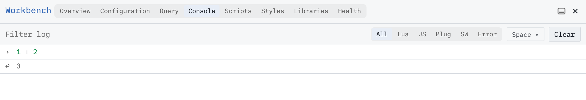

Copy a working query, change one condition and recognize the builder operations in its source.

# Set up a practice page
Use your own writable SilverBullet space; the published documentation is read-only. Open the page picker with **Cmd-k / Ctrl-k**, type `Photo Walk`, and press **Shift-Enter** to open that exact name. If you already have this example, reuse it and check it against the complete sample, including its attributes, task tags and checkbox states, instead of adding the content again. Otherwise, paste the following into the page body, without the surrounding backticks:

```markdown
---
tags: outing
status: planned
date: "2026-06-14"
---
Sam Rivera is planning a photo walk on 2026-06-14.

# Pack
* [ ] Charge camera battery #packing [due: "2026-06-13"]
* [ ] Pack binoculars #packing
* [x] Check the weather
```

SilverBullet saves automatically. Leave the two packing tasks unchecked and the weather task checked. Allow a moment for saving and indexing before checking the results. The dates are fixed example data.

# Start with a working query
Open the page picker with **Cmd-k / Ctrl-k**, type `Completed Walk Tasks`, and press **Shift-Enter**. Write `# Walk tasks`, then paste this complete expression below the heading, outside a code fence:

```markdown
${query[[
  from t = index.tasks()
  where not t.done and t.page == "Photo Walk"
  order by t.name
  limit 5
  select templates.taskItem(t)
]]}
```

Move the cursor to the heading so the query renders. You should see `Charge camera battery` followed by `Pack binoculars`, both unchecked. This is a live view of the source tasks; it does not duplicate or move them.

To inspect its controls first, open the result widget’s menu and choose **Edit in query builder**. Workbench shows the source, filters, order, limit and list template. To change the query visually, change the `done` filter from **is false** to **is true**, then click **Update page**. To try editing its source instead, leave the filter unchanged and follow the source-editing instructions below.

# Make one small change
Alt/Option-click the live list to reveal its `${query[[…]]}` source. Change `not t.done` to `t.done`. Leave the other conditions in place:

```markdown
${query[[
  from t = index.tasks()
  where t.done and t.page == "Photo Walk"
  order by t.name
  limit 5
  select templates.taskItem(t)
]]}
```

Move the cursor away. The result should show `Check the weather`. If other tasks on `Photo Walk` are complete, they will appear too.

# Match the text to the controls
* **From: task:** `from t = index.tasks()` — Read task records; call each one `t`.
* **Where:** `where …` — Keep only matching tasks. `and` requires both conditions.
* **Order By: name, A–Z:** `order by t.name` — Sort by task text.
* **Limit:** `limit 5` — Show at most five results.
* **Select: List, templates.taskItem:** `select templates.taskItem(t)` — Render each result as a task.

The `markdown` code blocks above show the text to paste into your page. A `${…}` expression pasted directly into your page evaluates it. Do not put this query in a `space-lua` block: those blocks define reusable space-wide code, which is a separate workflow.

# Optional: try Console
Open the command palette with **Cmd-/ / Ctrl-/**, run `Workbench: Console`, and enter `1 + 2`, then press Enter. The result is `3`. Next, paste just the inner `query[[…]]` from either example, without `${` and `}`. Inspect the result using **Rendered** or **Lua**. This runs the query without inserting it into a page; it does not change the tasks.

The builder can reopen many queries, but some handwritten expressions cannot be converted back into its controls. Keep a working copy when experimenting. Continue with [[Guide/Query Recipes]], [[Workbench/Console]] or the full [[Space Lua/Integrated Query|SLIQ reference]]. You can also return to writing plain notes whenever that is all you need.



A small expression in Console, after clearing earlier log entries.
