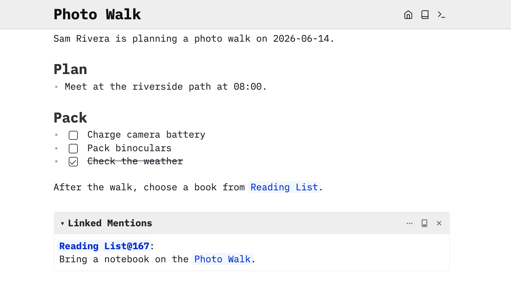
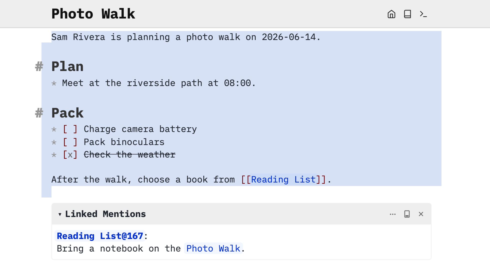

Create a page with ordinary text, a heading, a list, tasks and a link. You need a writable SilverBullet space; the documentation you are reading is read-only. Use an existing practice space or create one with [[Install/Desktop]] or [[Install]].

# Create Photo Walk
In your writable practice space, press **Cmd-k** on macOS or **Ctrl-k** on Windows/Linux to open the [[Page Picker]]. Type `Photo Walk`, then press **Shift-Enter** to open that exact name. If it does not exist, it becomes a new page when you write content.

On a new, empty page, paste the following text into its body, without the surrounding code-fence backticks. If `Photo Walk` already contains your own work, use a different page name for this example.

```markdown
Sam Rivera is planning a photo walk on 2026-06-14.

# Plan
* Meet at the riverside path at 08:00.

# Pack
* [ ] Charge camera battery
* [ ] Pack binoculars
* [x] Check the weather

After the walk, choose a book from [[Reading List]].
```

# Notice what changes
A blank line separates paragraphs. `# Plan` becomes a heading, `*` starts a bullet, and `* [ ]` becomes an unchecked task. `[x]` is a completed task. `[[Reading List]]` is a link to a page named `Reading List`. The destination does not have to exist yet: follow the link and write content there when you want to create it.

Move your cursor away from a formatted line to see [[Live Preview]]. Move back into it to edit the Markdown. Alt/Option-click a rendered element if you need to reveal its source. Clicking a checkbox changes the task’s state. Try checking and unchecking one of the packing tasks.

The filename provides the page title: you do not need to repeat `Photo Walk` as a heading. SilverBullet saves edits automatically; there is no Save button. Allow the save indicator in the [[Top Bar]] to settle before closing the application. Local Desktop spaces save to local files; browser access to Server has its own [[Sync|offline and synchronization behavior]].



The same note rendered with Live Preview.



Selecting the text reveals its Markdown punctuation.

# Find it again
Open the page picker, type part of the name you used, and choose your page. You should see your plan, the tasks with any state changes you made, and the reading-list link. That is already a useful note; you have not needed tags or code.

For more writing options, keep [[Markdown/Basics]] and [[Task]] nearby as references.
