A Space Lua library that draws diagrams with [Pele](https://pele.run/), a small, fast renderer for [Mermaid](https://mermaid.js.org/) syntax.

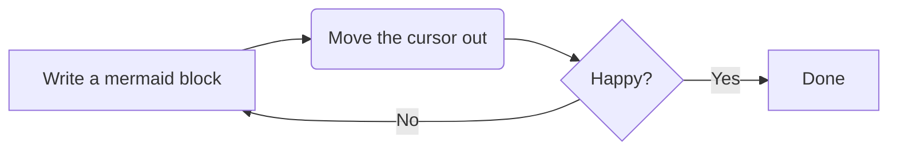

Pele reads the same text as Mermaid, but draws it with its own layout engine. Compared to the [Mermaid library](https://github.com/silverbulletmd/silverbullet-diagram/blob/main/Mermaid.md) you get:

* **Speed:** diagrams render in well under a millisecond, so they keep up with typing and with live queries.
* **Zoom and pan:** a diagram wider than the page shrinks to fit; pinch or Ctrl/⌘-scroll to zoom, drag to pan.
* **Theming:** colors follow your SilverBullet theme, including dark mode, without re-rendering.
* **Size:** one 730 KB file (230 KB compressed), against about 1.6 MB compressed for Mermaid.

Layouts differ from Mermaid's, labels can't contain raw HTML, and Mermaid plugins such as ZenUML are not supported. See [Pele's compatibility notes](https://pele.run/compatibility).

> **warning** Pele or Mermaid: *not* both
> This library and the Mermaid library both draw ` ```mermaid ` blocks. Install one of the two.

# Installation
1. Run the **`Library: Install`** command (or open the **Libraries** manager and click **Install**).
2. When prompted for a library URI, paste: `github:silverbulletmd/silverbullet-libraries@main/Library/silverbulletmd/Pele.md`

By default Pele loads from [jsDelivr](https://www.jsdelivr.com/package/npm/pele). To work offline or without a CDN, run **`Pele: Download bundle for offline use`**: it saves Pele into your space, and from then on that copy is used.

# Static diagrams
Write a fenced `mermaid` block and move your cursor out of it:

    ```mermaid
    flowchart TD
        Start --> Stop
    ```

Put your cursor in a diagram to edit its source. Errors show the line and column Pele got stuck on.

## Links
Clicking a linked node navigates within your space; Ctrl/Cmd-click opens it in a new window. Two ways to link a node:

* `click A "Some Page"`: links node `A` to the page *Some Page*. Use `#quot;` for a `"` in a page name, and start a name that has a colon with `./` (`click A "./ADR:001"`), or Pele reads it as a web address.
* `class A internal-link`: links node `A` to the page named by its label (as in Obsidian).

`http`, `https`, `mailto` and `tel` links, such as `click A "https://silverbullet.md"`, open in a new browser tab.

# Dynamic diagrams
Diagrams can be generated from your space's data and redraw when it changes, like query tables. The view functions return Mermaid source, which you pass to `pele.diagram`:

    ${pele.diagram(pele.relationGraph{
      pages = query[[from index.pages("adr")]],
    })}

Because a view returns text, you can also look at it, adjust it, or paste it into a static block. Sizing goes in `pele.diagram`'s options, not the view: `pele.diagram(pele.timeline{…}, { maxWidth = 600 })`.

# API
## pele.diagram(source, opts)
Renders Mermaid `source` as a widget. `opts` *(optional)* is passed to Pele:

* `zoom`: `"auto"` (default; zoom and pan only when the diagram is shrunk to fit), `true` or `false`.
* `maxWidth`: maximum width in pixels (a number, e.g. `600`).
* `fontSize`: base font size in pixels (default 16).
* `autoDirection`: on by default, so Pele turns wide flowcharts vertical when they don't fit; `false` keeps the direction as written.
* `padding`: padding around the diagram in pixels.
* `config`: Mermaid settings, such as `{ flowchart = { curve = "linear" } }`. Support varies by diagram type.

## pele.relationGraph(spec)
A flowchart of frontmatter relations between pages. Nodes are labeled with the last segment of the page name, and clicking one opens the page.

* `pages`: the pages to draw, e.g. `query[[from index.pages("adr")]]`.
* `relations` *(optional)*: frontmatter fields holding `[[page]]` links to draw as edges, e.g. `{"dependsOn", "related"}`. When omitted, every field whose values are `[[links]]` to pages in the set becomes an edge, labeled with the field name. `supersededBy` edges are dotted. Quote links in frontmatter (`dependsOn: "[[Page]]"`): that's the form YAML keeps as text. Short links work as they do elsewhere in SilverBullet: `[[ADR/001]]` finds `Docs/ADR/001`.
* `groupBy` *(optional)*: a field naming a container page; pages nest inside a box with their container as its first node, as many levels deep as you like.
* `direction` *(optional)*: `"LR"` (default), `"TD"`, `"RL"` or `"BT"`.
* `color` *(optional)*: a field whose value becomes a class on the node, passed through `pele.id` (so `In Progress` becomes `In_Progress`). Append `classDef` lines to style them:

      ${pele.diagram(pele.relationGraph{
        pages = query[[from index.pages("adr")]],
        color = "status",
      } .. "\n  classDef accepted fill:#d3f0d6\n  classDef proposed fill:#fdf0c4")}
* `max` *(optional, default 60)*: node limit. A final node says how many pages were left out.

## pele.timeline(spec)
A timeline of pages by a date field.

* `pages`: the pages to lay out.
* `dateField` *(default `"date"`)*: a field holding a `YYYY-MM-DD` date. Pages without one are skipped.
* `groupBy` *(default `"year"`)*: `"year"` groups entries under their year; `"none"` gives one entry per date.
* `labelField` *(optional)*: a field to use as the entry label, instead of the page name.
* `title` *(optional)*: the diagram title.
* `max` *(optional, default 100)*: entry limit. The title says how many entries are shown when some are left out.

## pele.distribution(spec)
A pie chart counting pages by a field, largest slice first. A list field, such as `tags`, counts each item.

* `pages`: the pages to count.
* `by`: the field to count by, e.g. `"status"`.
* `emptyLabel` *(optional)*: a label for pages without a value; omit to leave them out.
* `title` *(optional)*: the chart title.
* `showData` *(optional)*: show the counts next to the slices.

## Helpers
* `pele.id(text)`: a valid Mermaid id or class name for any text. Characters other than letters, digits and `_` become `_`, so different texts can share an id; Mermaid keywords such as `end` get an `n_` prefix.
* `pele.label(text)`: `text` as a quoted Mermaid label, with `"` and `#` escaped.
* `pele.supports(source)`: whether Pele can draw `source`.
* `pele.detectType(source)`: the diagram type of `source`, such as `"flowchart"`, or `nil`.

# Configuration
Everything works out of the box. To change where Pele loads from:

```lua
config.set("pele", {
  -- Loaded when no offline copy exists, and fetched by the download command
  cdnUrl = "https://cdn.jsdelivr.net/npm/pele@1.13.0/dist/pele.js",
  -- Where the offline copy is saved and loaded from
  bundlePath = "Library/silverbulletmd/Pele/pele.js",
})
```

Diagram colors come from your theme. To change them, set Pele's [CSS variables](https://pele.run/theming) on `.sb-pele` in a `space-style` block:

```css
.sb-pele {
  --pele-accent: hotpink;
}
```

# Diagram types
The first line of a block names its type.

| Type | First line |
|------|------------|
| Flowchart | `flowchart` or `graph` |
| Swimlane | `swimlane-beta` |
| Sequence | `sequenceDiagram` |
| Class | `classDiagram` |
| State | `stateDiagram` or `stateDiagram-v2` |
| Entity relationship | `erDiagram` |
| Gantt | `gantt` |
| Git graph | `gitGraph` |
| Pie | `pie` |
| Mind map | `mindmap` |
| Kanban | `kanban` |
| Timeline | `timeline` |
| User journey | `journey` |
| Quadrant chart | `quadrantChart` |
| XY chart | `xychart` or `xychart-beta` |
| Requirement | `requirementDiagram` |
| Sankey | `sankey` or `sankey-beta` |
| Architecture | `architecture-beta` |
| C4 | `C4Context`, `C4Container`, `C4Component`, `C4Dynamic` or `C4Deployment` |
| Block | `block` or `block-beta` |
| Agent flow | `agentflow-beta` |
| Railroad | `railroad-beta`, `railroad-ebnf-beta`, `railroad-abnf-beta` or `railroad-peg-beta` |
| Tree view | `treeView-beta` |
| Cynefin | `cynefin-beta` |
| Wardley map | `wardley-beta` |
| Event modeling | `eventmodeling` |
| Use case | `usecase-beta` |
| Venn | `venn-beta` |
| Ishikawa | `ishikawa` or `ishikawa-beta` |
| Packet | `packet` or `packet-beta` |
| Radar | `radar-beta` |
| Treemap | `treemap` or `treemap-beta` |
| Info | `info` |

# Examples
Put your cursor in any example to see its source.

## Flowchart
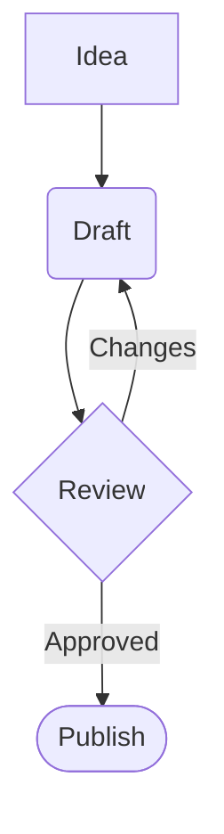

## Sequence
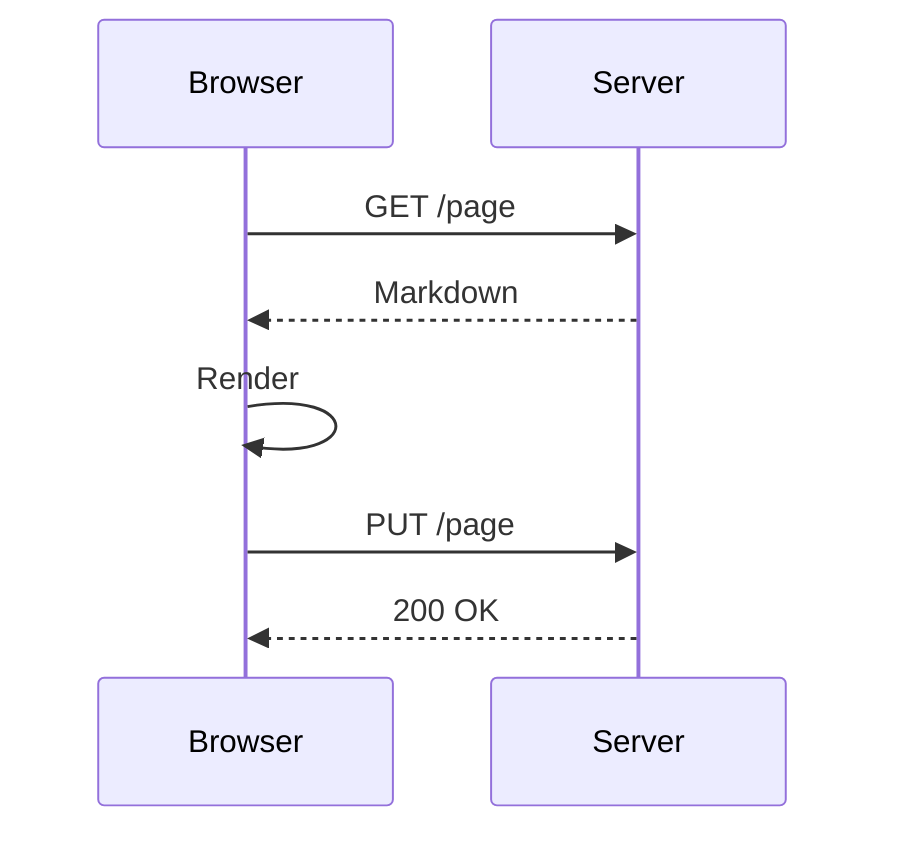

## Class
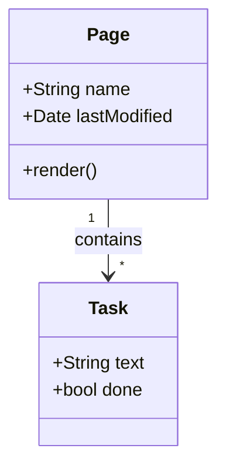

## State
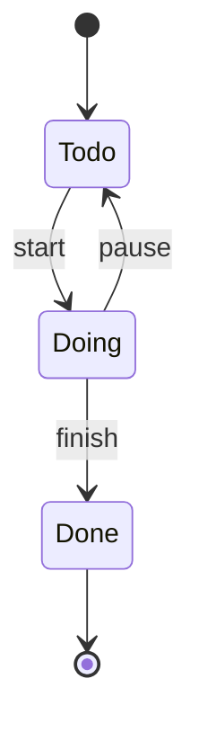

## Entity relationship
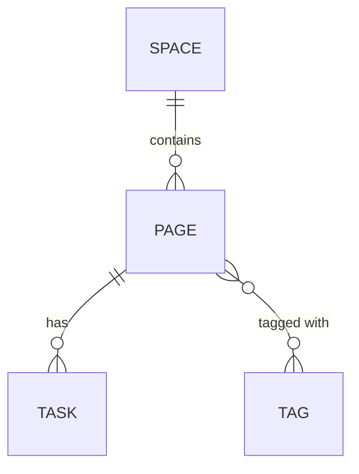

## Gantt
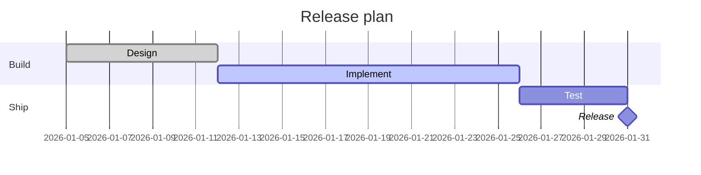

## Git graph
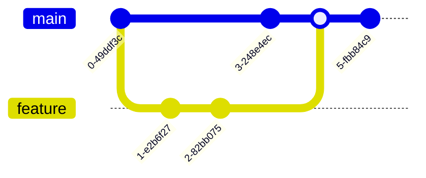

## Pie
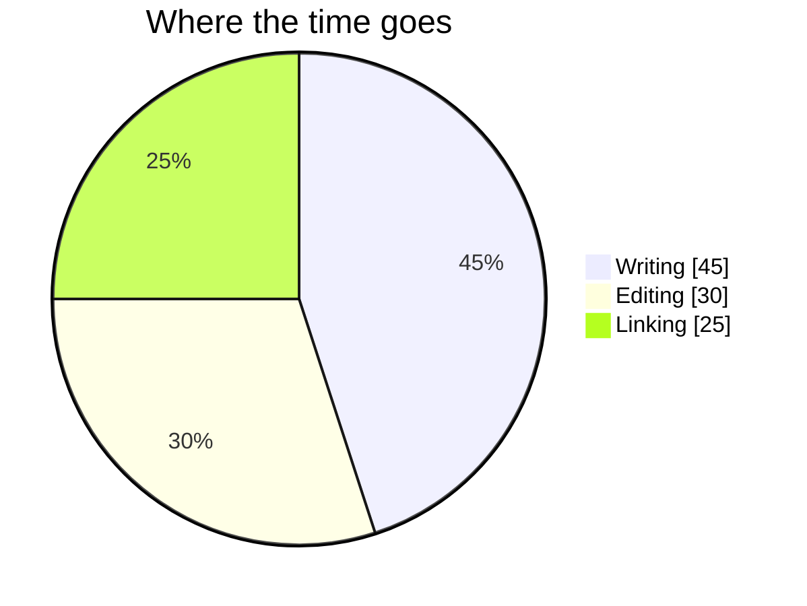

## Mind map
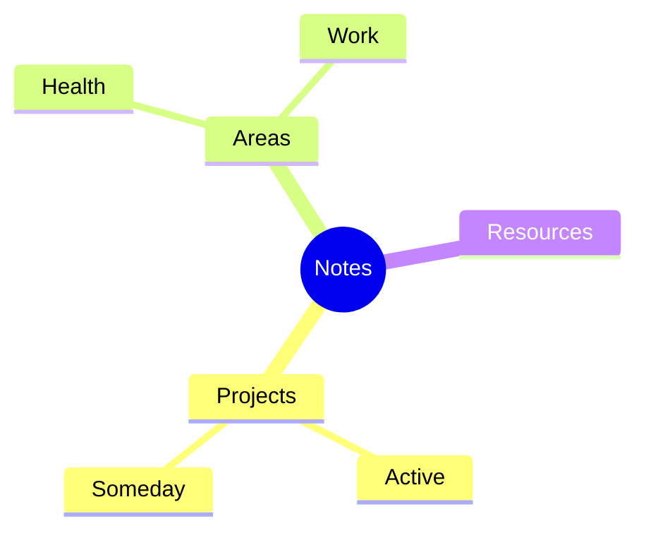

## Timeline
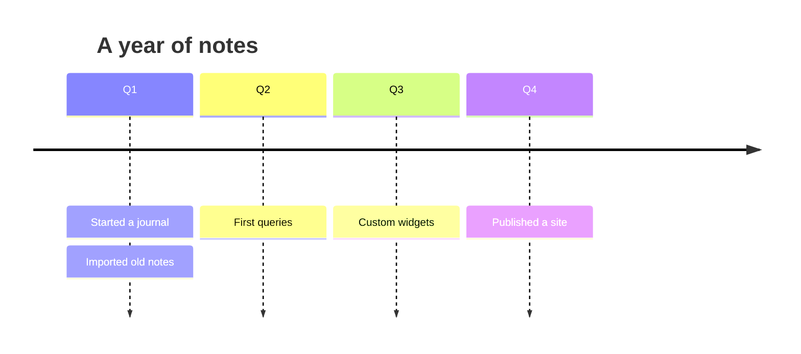

## User journey
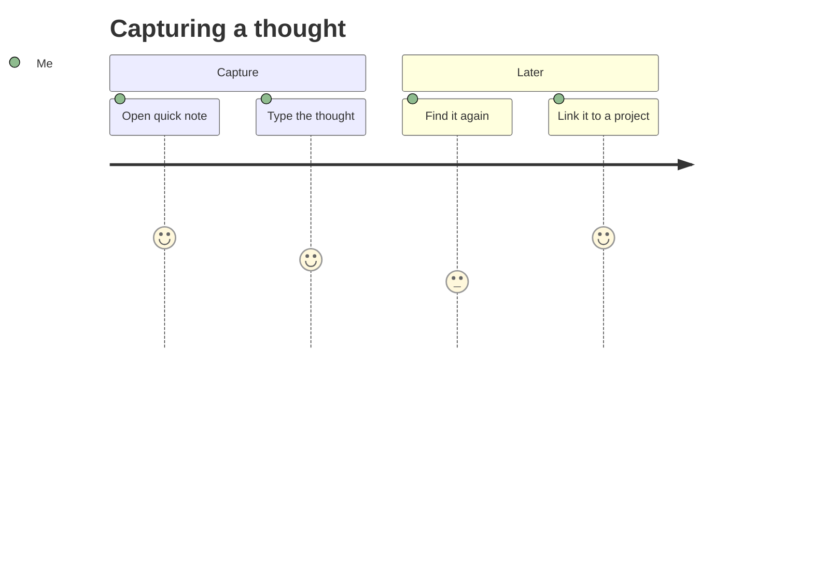

## Quadrant chart
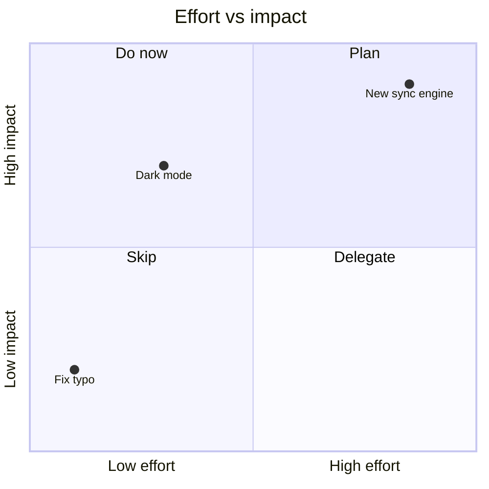

## XY chart
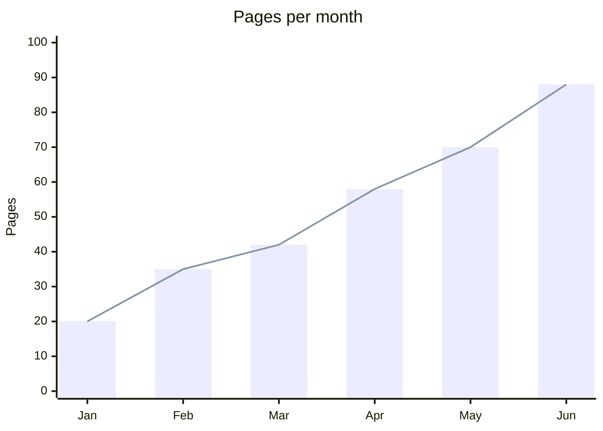

## Sankey
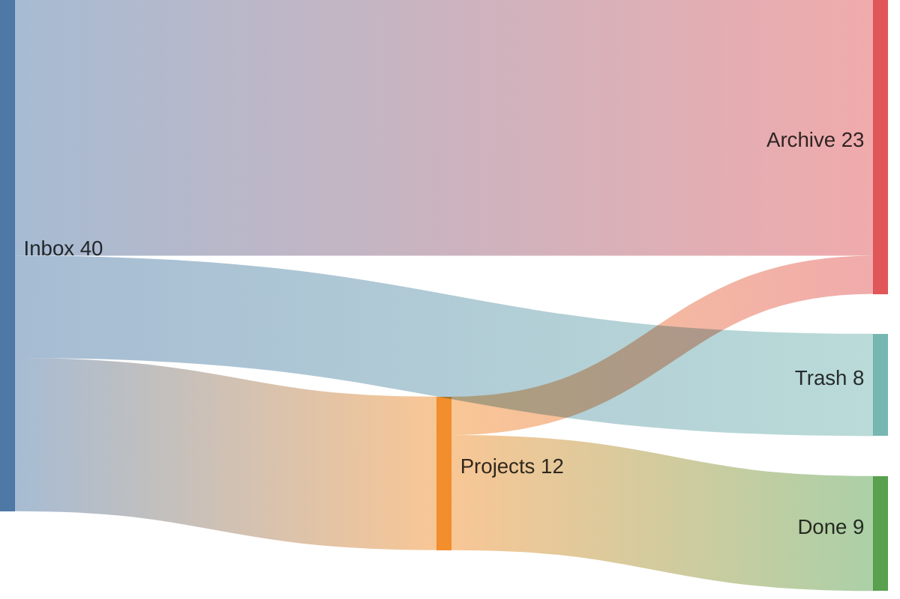

## Kanban
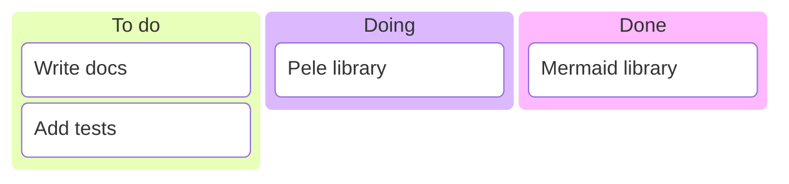

## Architecture
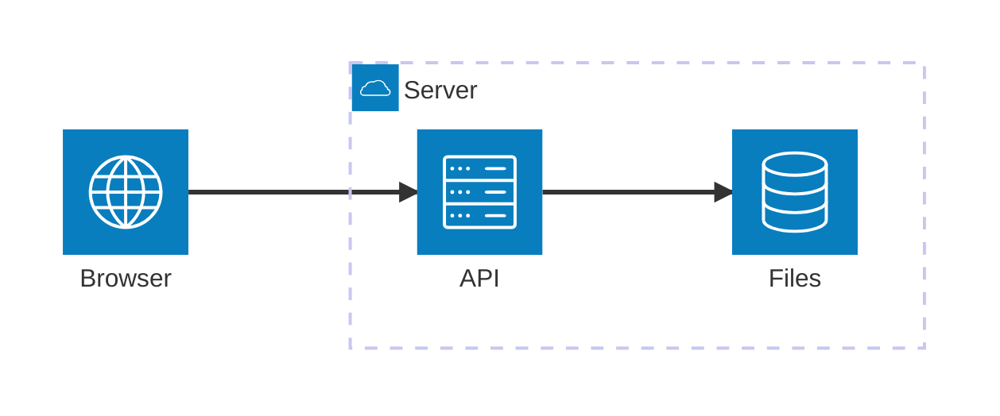

## From your space
The tags on your pages (outside `Library/`), counted live:

${pele.diagram(pele.distribution{
  pages = query[[from p = index.pages() where not p.name:startsWith("Library/") limit 500]],
  by = "tags",
  emptyLabel = "untagged",
  title = "Pages by tag",
})}

# Implementation

```space-lua
pele = pele or {}

local PELE_DEFAULTS = {
  cdnUrl = "https://cdn.jsdelivr.net/npm/pele@1.13.0/dist/pele.js",
  bundlePath = "Library/silverbulletmd/Pele/pele.js",
}

local function peleConfig()
  local cfg = config.get("pele", {})
  return {
    cdnUrl = cfg.cdnUrl or PELE_DEFAULTS.cdnUrl,
    bundlePath = cfg.bundlePath or PELE_DEFAULTS.bundlePath,
  }
end

function pele.load()
  if pele._module then return pele._module end
  local cfg = peleConfig()
  local m
  if space.fileExists(cfg.bundlePath) then
    m = js.importFromSpace(cfg.bundlePath)
  else
    m = js.import(cfg.cdnUrl)
  end
  pele._module = m
  return m
end

function pele.diagram(source, opts)
  if type(source) ~= "string" then
    error("pele.diagram: source must be a string, got " .. type(source))
  end
  local m = pele.load()
  local div = js.window.document.createElement("div")
  div.className = "sb-pele"
  local mountOpts = { zoom = "auto" }
  for k, v in pairs(opts or {}) do mountOpts[k] = v end
  m.mount(div, source, mountOpts)
  return widget.new {
    html = div,
    display = "block",
    markdown = "```mermaid\n" .. source .. "\n```",
    events = {
      click = function(e)
        local ok, internal, href = pcall(function()
          local t = e.data.target
          -- When zoomed in, Pele captures the pointer for panning, so the
          -- click lands on the container: use what's under the cursor instead
          if not t.closest("a, .pele-node") then
            t = js.window.document.elementFromPoint(e.data.clientX, e.data.clientY) or t
          end
          local a = t.closest("a")
          -- An internal-link node only wraps its label text in the link, so a
          -- click anywhere else on the node looks the link up from the node
          if not a then
            local node = t.closest(".pele-node")
            if node then a = node.querySelector("a") end
          end
          if not a then return nil end
          return a.getAttribute("data-href"), a.getAttribute("href")
        end)
        if not ok then return end
        -- Pele only sets data-href on `class X internal-link` nodes, so that is
        -- always a page; a plain href is a page unless it has one of the URL
        -- schemes Pele allows (page names like "Book: Dune" contain colons)
        local target = internal
        if not target and href then
          local lower = string.lower(href)
          if string.match(lower, "^https?:") or string.match(lower, "^mailto:")
              or string.match(lower, "^tel:") then
            -- Opening in place would replace SilverBullet in a browser tab
            e.data.preventDefault()
            editor.openUrl(href)
            return
          end
          target = href
        end
        if not target or target == "" then return end
        e.data.preventDefault()
        target = string.match(target, "^%[%[(.*)%]%]$") or target
        -- "./" lets a click target like "ADR:001" pass Pele's scheme check
        target = string.match(target, "^%./(.*)$") or target
        -- Ctrl/Cmd-click opens a new window, as other links in SilverBullet do
        local newWindow = e.data.ctrlKey or e.data.metaKey
        local navigated, err = pcall(editor.navigate, target, false, newWindow)
        if not navigated then
          editor.flashNotification("Can't open " .. target .. ": " .. tostring(err), "error")
        end
      end,
    },
  }
end

-- Text helpers ------------------------------------------------------------

-- Words Mermaid reads as keywords, so they can't be ids or class names
local RESERVED = {
  ["end"] = true, ["class"] = true, ["classdef"] = true, ["style"] = true,
  ["linkstyle"] = true, ["subgraph"] = true, ["graph"] = true,
  ["flowchart"] = true, ["click"] = true, ["call"] = true, ["href"] = true,
  ["direction"] = true, ["default"] = true,
}

-- A valid Mermaid identifier for an arbitrary string. Characters other than
-- letters, digits and `_` become `_`, so different texts can share an id.
function pele.id(raw)
  local id = string.gsub(tostring(raw), "[^%w_]", "_")
  if not string.match(id, "^[%a_]") or RESERVED[string.lower(id)] then
    id = "n_" .. id
  end
  return id
end

-- A double-quoted Mermaid label. `#` and `"` become Mermaid entities, so text
-- like "#59;" stays literal.
function pele.label(text)
  local s = string.gsub(tostring(text), "#", "#35;")
  s = string.gsub(s, '"', "#quot;")
  return '"' .. s .. '"'
end

-- Text for a line-based position (titles, timeline entries): one line, and no
-- `%%`, which would start a comment.
local function oneLine(text)
  local s = string.gsub(tostring(text), "[\r\n]+", " ")
  s = string.gsub(s, "%%%%", function() return "% %" end)
  return s
end

function pele.supports(source)
  return pele.load().supports(source)
end

function pele.detectType(source)
  return pele.load().detectType(source)
end

local function shortName(name)
  return (string.match(name, "[^/]+$")) or name
end

-- The page a link value points to: "[[Page]]", "[[Page|alias]]",
-- "[[Page#Header]]" or "Page"; for a list, its first value. Unquoted
-- [[Page]] in YAML arrives as a nested list, which this unwraps too.
local function deref(v)
  while type(v) == "table" do v = v[1] end
  if type(v) ~= "string" then return nil end
  v = string.match(v, "^%[%[(.-)%]%]$") or v
  return (string.match(v, "^([^|#]*)"))
end

-- Views: Mermaid source built from the object index ------------------------

-- A flowchart of frontmatter relations between pages.
function pele.relationGraph(spec)
  spec = spec or {}
  local groupBy = spec.groupBy
  local max = spec.max or 60

  local pages = {}
  for _, p in ipairs(spec.pages or {}) do
    if type(p) == "table" and type(p.name) == "string" then pages[#pages + 1] = p end
  end
  table.sort(pages, function(a, b) return string.lower(a.name) < string.lower(b.name) end)

  local idOf, order = {}, {}
  for _, p in ipairs(pages) do
    if #order >= max then break end
    order[#order + 1] = p
    idOf[p.name] = "n" .. #order
  end

  -- Links resolve the way SilverBullet resolves them: an exact name first,
  -- then a unique name or path suffix, case-insensitively, so [[ADR/001]]
  -- finds "Docs/ADR/001". Only pages in the graph count; a link that matches
  -- several of them (and none in exact case) draws nothing.
  local bySuffix = {}
  for _, p in ipairs(order) do
    local segs = {}
    for seg in string.gmatch(p.name, "[^/]+") do segs[#segs + 1] = seg end
    for i = 1, #segs do
      local key = string.lower(table.concat(segs, "/", i, #segs))
      bySuffix[key] = bySuffix[key] or {}
      table.insert(bySuffix[key], p.name)
    end
  end
  local function resolve(name)
    if not name then return nil end
    name = string.match(name, "^/?(.-)$")
    if idOf[name] then return name end
    local candidates = bySuffix[string.lower(name)]
    if not candidates then return nil end
    if #candidates == 1 then return candidates[1] end
    local exactCase
    for _, c in ipairs(candidates) do
      if c == name or string.sub(c, -(#name + 1)) == "/" .. name then
        if exactCase then return nil end
        exactCase = c
      end
    end
    return exactCase
  end

  local lines = { "flowchart " .. (spec.direction or "LR") }
  local function node(p, indent)
    local cls = spec.color and p[spec.color]
    if type(cls) == "table" then cls = cls[1] end
    lines[#lines + 1] = indent .. idOf[p.name] .. "(" .. pele.label(shortName(p.name)) .. ")" ..
      ((cls ~= nil and cls ~= "") and (":::" .. pele.id(cls)) or "")
    -- "./" keeps Pele from reading a name like "ADR:001" as a URL scheme
    lines[#lines + 1] = indent .. "click " .. idOf[p.name] .. " " .. pele.label("./" .. p.name)
  end

  -- Pages others point to with `groupBy` become boxes around them, nested as
  -- deep as the containers go. The container itself is the box's first node,
  -- so it can be clicked, colored and linked to like any other page.
  local childrenOf, hasParent = {}, {}
  if groupBy then
    for _, p in ipairs(order) do
      local c = resolve(deref(p[groupBy]))
      if c and c ~= p.name then
        childrenOf[c] = childrenOf[c] or {}
        table.insert(childrenOf[c], p)
        hasParent[p.name] = true
      end
    end
  end
  local emitted = {}
  local function emit(p, indent)
    if emitted[p.name] then return end
    emitted[p.name] = true
    local children = childrenOf[p.name]
    if not children then
      node(p, indent)
      return
    end
    lines[#lines + 1] = indent .. "subgraph " .. idOf[p.name] .. "_box [\" \"]"
    node(p, indent .. "  ")
    for _, child in ipairs(children) do emit(child, indent .. "  ") end
    lines[#lines + 1] = indent .. "end"
  end
  for _, p in ipairs(order) do
    if not hasParent[p.name] then emit(p, "  ") end
  end
  -- Whatever is left belongs to a groupBy cycle
  for _, p in ipairs(order) do emit(p, "  ") end

  -- The page a relation value links to. In auto mode only [[links]] count
  -- (quoted, or unquoted, which YAML reads as a nested list); named relations
  -- take any value.
  local function linkTarget(t, requireLink)
    if type(t) == "table" then return deref(t) end
    if type(t) ~= "string" then return nil end
    if requireLink and not string.match(t, "^%[%[") then return nil end
    return deref(t)
  end
  local function addEdges(fromId, field, value, requireLink)
    if type(value) ~= "table" then value = { value } end
    for _, t in ipairs(value) do
      local toId = idOf[resolve(linkTarget(t, requireLink))]
      if toId and toId ~= fromId then
        local op = field == "supersededBy" and "-.->" or "-->"
        lines[#lines + 1] = "  " .. fromId .. " " .. op .. "|" .. pele.label(field) .. "| " .. toId
      end
    end
  end
  for _, p in ipairs(order) do
    local fromId = idOf[p.name]
    if spec.relations then
      for _, rel in ipairs(spec.relations) do addEdges(fromId, rel, p[rel], false) end
    else
      local keys = {}
      for key in pairs(p) do
        if type(key) == "string" and key ~= groupBy then keys[#keys + 1] = key end
      end
      table.sort(keys)
      for _, key in ipairs(keys) do addEdges(fromId, key, p[key], true) end
    end
  end

  if #order < #pages then
    lines[#lines + 1] = "  n_more[" .. pele.label("… and " .. (#pages - #order) .. " more pages") .. "]"
  end
  return table.concat(lines, "\n")
end

-- A timeline of pages by a YYYY-MM-DD date field.
function pele.timeline(spec)
  spec = spec or {}
  local dateField = spec.dateField or "date"
  local groupBy = spec.groupBy or "year"
  local max = spec.max or 100

  -- A colon separates timeline fields, so labels can't contain one
  local function clean(s)
    local out = string.gsub(oneLine(s), ":", " ")
    out = string.gsub(out, "#", "#35;")
    return out
  end
  local function labelOf(p)
    if spec.labelField and p[spec.labelField] ~= nil then return clean(p[spec.labelField]) end
    if type(p.name) == "string" then return clean(shortName(p.name)) end
    return nil
  end

  local pages = {}
  for _, p in ipairs(spec.pages or {}) do
    local d = type(p) == "table" and p[dateField]
    if type(d) == "string" and string.match(d, "^%d%d%d%d%-%d%d%-%d%d") and labelOf(p) then
      pages[#pages + 1] = p
    end
  end
  table.sort(pages, function(a, b) return a[dateField] < b[dateField] end)

  local shown = math.min(#pages, max)
  local title = spec.title and clean(spec.title)
  if shown < #pages then
    local note = "showing " .. shown .. " of " .. #pages
    title = title and (title .. " (" .. note .. ")") or note
  end
  local lines = { "timeline" }
  if title then lines[#lines + 1] = "  title " .. title end
  if groupBy == "year" then
    local years, byYear = {}, {}
    for i = 1, shown do
      local year = string.sub(pages[i][dateField], 1, 4)
      if not byYear[year] then
        byYear[year] = {}
        years[#years + 1] = year
      end
      table.insert(byYear[year], labelOf(pages[i]))
    end
    for _, year in ipairs(years) do
      lines[#lines + 1] = "  " .. year .. " : " .. table.concat(byYear[year], " : ")
    end
  else
    for i = 1, shown do
      lines[#lines + 1] = "  " .. clean(pages[i][dateField]) .. " : " .. labelOf(pages[i])
    end
  end
  return table.concat(lines, "\n")
end

-- A pie counting pages by a field; list values (like tags) count once per item.
function pele.distribution(spec)
  spec = spec or {}
  local by = spec.by
  if not by then error("pele.distribution: `by` is required") end

  local counts, order = {}, {}
  local function count(v)
    if v == nil or v == "" then v = spec.emptyLabel end
    if v == nil then return end
    v = tostring(v)
    if not counts[v] then
      counts[v] = 0
      order[#order + 1] = v
    end
    counts[v] = counts[v] + 1
  end
  for _, p in ipairs(spec.pages or {}) do
    local v = type(p) == "table" and p[by] or nil
    if type(v) == "table" then
      if #v == 0 then count(nil) end
      for _, item in ipairs(v) do count(item) end
    else
      count(v)
    end
  end
  table.sort(order, function(a, b)
    if counts[a] ~= counts[b] then return counts[a] > counts[b] end
    return a < b
  end)

  local lines = { spec.showData and "pie showData" or "pie" }
  if spec.title then lines[#lines + 1] = "  title " .. oneLine(spec.title) end
  for _, label in ipairs(order) do
    lines[#lines + 1] = "  " .. pele.label(label) .. " : " .. counts[label]
  end
  return table.concat(lines, "\n")
end

-- Pele is one self-contained file, so going offline is a single download
command.define {
  name = "Pele: Download bundle for offline use",
  run = function()
    local cfg = peleConfig()
    editor.flashNotification("Downloading Pele…")
    local res = net.proxyFetch(cfg.cdnUrl, { responseEncoding = "text/plain" })
    if not (res and res.ok) then
      editor.flashNotification("Pele download failed: HTTP " .. tostring(res and res.status), "error")
      return
    end
    space.writeFile(cfg.bundlePath, js.new(js.window.TextEncoder).encode(res.body))
    editor.flashNotification(
      "Pele installed for offline use — reload to use it.",
      "info",
      { actions = { { name = "Reload", run = function() editor.reloadUI() end } } }
    )
  end
}

codeWidget.define {
  language = "mermaid",
  render = function(body)
    return pele.diagram(body)
  end
}
```

```space-style
/* Pele colors diagrams with CSS variables; map them onto the editor theme so
   light/dark switches apply without re-rendering. */
.sb-pele {
  --pele-bg: var(--root-background-color);
  --pele-fg: var(--root-color);
  --pele-line: color-mix(in srgb, var(--root-color) 75%, var(--root-background-color));
  --pele-muted: var(--subtle-color);
  --pele-surface: color-mix(in srgb, var(--root-color) 6%, var(--root-background-color));
  --pele-surface-alt: color-mix(in srgb, var(--root-color) 12%, var(--root-background-color));
  --pele-border: color-mix(in srgb, var(--root-color) 40%, var(--root-background-color));
  --pele-accent: var(--ui-accent-color);
  --pele-font: var(--ui-font);
}
.sb-pele .pele-node:has(a) {
  cursor: pointer;
}
```
